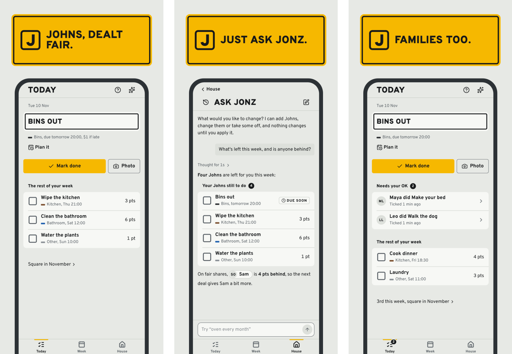

<p align="center">
  <a href="https://jonz.app">
    
  </a>
</p>

<p align="center">
  <a href="https://jonz.app"><b>jonz.app</b></a> · iPhone and Android on the way · <a href="docs/brand/README.md">Brand</a>
</p>

In our house the week's chores were always called Johns, so that is what
Jonz calls them: one chore is a **John**. List the house's Johns once, and
every week Jonz shares them out so the work evens out over the month. The
house checks each tick, and the month's Stake settles who did their share.
A family can use it too: parents OK the kids' ticks, and kids earn pocket
money in place of the Stake.

<p align="center">
  
</p>

## What it does

- **Fair shares, dealt for you.** Every John has points (1 to 20), a kind,
  a due day and a repeat. Each week the Johns are dealt so the work evens
  out, and the bathroom moves around. Smart mode weighs who's behind, who
  did it last and what each person would rather do; Classic takes turns in
  order. A points budget keeps anyone's week from getting too full.
- **Groups.** Three of you share the upstairs bathroom and two the
  downstairs one? Put each bathroom's Johns in a group, and only that group
  is dealt them, and only they count toward its share.
- **On call, covering and shared Johns.** An on-call John (the bins when
  they're full) goes to whoever is on call that week when anyone flags it.
  An overdue John can be covered by someone else, who earns it. A big John
  can be done together, with the points split among whoever helped.
- **Plan it and swap.** Pick the day you'll do a John, or offer it to a
  housemate in a swap.
- **Time away that stays fair.** Book your dates and you aren't dealt Johns
  due while you're gone, but your share keeps counting, so you catch up a
  little each week when you're back (the house can make that half, or none).
  A month calendar shows who's away.
- **Housemate check.** A tick stands after 24 hours unless someone disputes
  it; disputes go to a quick house vote. Photo receipts are optional, or
  required on the Johns you choose. Most things can be undone.
- **The Stake.** Everyone stakes the same each month. Late and missed Johns
  forfeit part of it, and at month end the forfeits are shared among
  everyone else. Jonz keeps the ledger and works out who pays whom, or the
  house settles up in Splitwise; Jonz never moves money.
- **Families.** A family house has parents and kids. A parent OKs each
  kid's tick, kids earn pocket money up to a monthly cap, and kids under 13
  can have a profile a parent runs, with no sign-in. Every sentence speaks
  to a family, never to housemates.
- **The Table, streaks and perks.** Points for every John done (half for
  late). Four clean weeks in a row earn an immunity token; topping the week
  earns a swap. The track record shows each person's weeks at a glance.
- **The Wall.** Ticks, photos, misses, disputes and perks as they happen,
  with reactions.
- **Ask Jonz.** Describe the house in a sentence and Jonz drafts the John
  list. Later, ask it anything about the house, or to make a change: it
  shows each change on a card for you to OK first. Chats are saved.
- **Reminders** by push notification, with quiet hours. Tick a John, or
  answer a housemate's dispute, from the notification itself.
- **Help built in.** Short tours, a guide, and Report a problem from inside
  the app, answered by email.
- **The House Pass.** One price for the whole house, $49.99 a year (or
  $5.99 a month), with a free month first.

It works on any phone and spreads out on a laptop, in the Bin Night house
style: council signage, hi-vis amber, a bin-lid colour per kind of John.
Invite links show the house's name when you paste them into the group chat.

## Stack

| | |
| --- | --- |
| The app | Expo (SDK 58, Expo Router) for iOS, Android and the web, at [jonz.app](https://jonz.app) |
| The API | Next.js 16 route handlers on Vercel, at api.jonz.app |
| The way in | One list of every operation (`@app/server`): the app, Ask Jonz, the `/v1` API and MCP all go through it, so nothing reaches the database directly |
| Data | Supabase: Postgres with RLS, Auth (Google, Microsoft, email and password, and Apple on iOS), Storage, Realtime, pg_cron |
| Words | Every sentence in words files, read with FormatJS, with a family's own sentences; ready for other languages |
| Ask Jonz | Claude, calling the same operations as the app |
| Money | Stripe Checkout for the House Pass |
| Email | Resend, both ways |
| Tests | Vitest, Jest and Playwright, on GitHub Actions |
| Staging | staging.jonz.app, with its own database and a demo house |

The same shape as Pub Golf, Graph Editor and glyn.dev, in an npm workspace
shaped like `glynfinck/app-template`. `AGENTS.md` says how it fits together
and why.

## Repo map

| Folder | What's in it |
| --- | --- |
| [`packages/core`](packages/core) | The pure rules (week, deal, points, streaks, the Stake, disputes), the operation registry, the words files, and Bin Night's colours and mark |
| [`packages/server`](packages/server) | The one way in: every operation's checks, in order |
| [`apps/client`](apps/client) | The Expo app for iOS, Android and the web, at jonz.app: screens in `src/app`, Bin Night in `src/components` |
| [`apps/api`](apps/api) | The API at api.jonz.app: `/v1` and MCP, the clock, Stripe, push, email and link cards; the engine in `lib/engine`; database tests in `tests/db`; end-to-end tests in `e2e` |
| [`supabase`](supabase) | Migrations (schema, RLS, the housemate functions, the cron job) and staging's demo house |
| [`scripts`](scripts) | Provision, staging, the clock by hand, VAPID keys, the brand images, the store release gate |
| [`docs/specs`](docs/specs) | One short spec per feature |
| [`docs/style`](docs/style) | The house style, and each design pick |
| [`docs/standards`](docs/standards) | How the database is built (CI checks it) |
| [`docs/brand`](docs/brand) | The brand guide and every brand image |

`AGENTS.md` has the detail.

## Develop

Node 22, Docker, the Supabase CLI.

```sh
npm ci
cp supabase/.env.example supabase/.env.local
supabase start                                  # ports 54340–54344
cp apps/api/.env.example apps/api/.env.local    # then fill in from `supabase status -o env`
npm run dev                                     # the API on http://localhost:3205
npm run dev:client                              # the app: Metro on 8205 (w for web)
```

The app reads `apps/client/.env.local` (copy `.env.example`). Its web build
signs in in the browser; on iOS and Android, sign-in needs a development
build (`npx expo run:ios` / `run:android` in `apps/client`; Expo Go can't)
and Google's app clients (`DEPLOYMENT.md`).

To use the app locally without a Google client, create a user in Studio
(http://127.0.0.1:54343) and sign in the way `apps/api/e2e/auth.ts` does, or
configure a Google OAuth client for localhost.

## Test

```sh
npm test            # the pure rules (@app/core), the app's Jest, the scripts' decisions; no stack
npm run test:db     # RLS, the housemate functions and the engine, on the local stack
npm run test:e2e    # Playwright on the web build: Pixel 7, iPhone 15, desktop Firefox, a 1440px laptop
```

CI runs these side by side on every pull request, and `main` merges only
when `verify` is green.

## Brand

Every icon, favicon, card and banner is drawn from one mark with
`npm run brand`. [`docs/brand/README.md`](docs/brand/README.md) has the
logo, colours, type, voice, where each image goes, and the steps for the
dashboards that take a logo by hand.

## Deploy

See `DEPLOYMENT.md`. Store releases stay off in `release-targets.json` until
the store accounts exist.

## Later

The iPhone and Android apps in the stores, other languages, bounties, pay
links to settle up, a calendar feed, more than one house per person, and
posts in the house group chat.

## Contributing, security and licence

Report a problem, send an idea or ask a question from inside Jonz (House,
then Help), or email support@jonz.app: [jonz.app/help](https://jonz.app/help)
says how. [CONTRIBUTING.md](CONTRIBUTING.md) says how to work on the code. Report
security problems privately, as [SECURITY.md](SECURITY.md) says. The code is
public to read, not to reuse: see [LICENSE](LICENSE).
